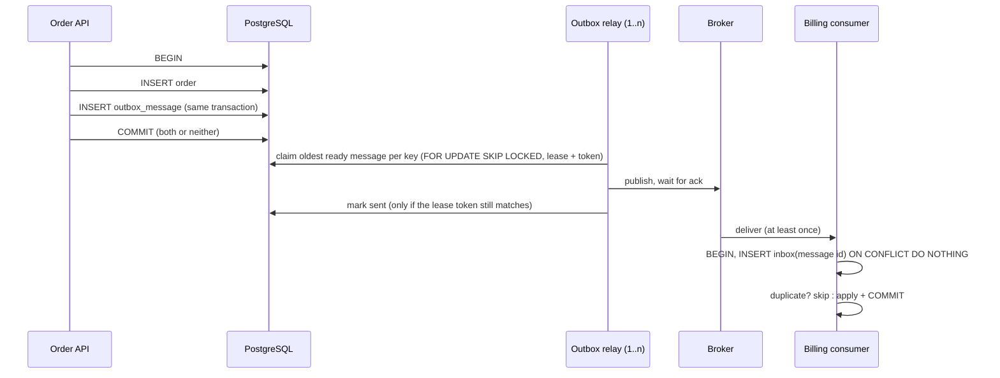

# transactional-outbox-dotnet

**You saved the order and then published `OrderPlaced`. The process died between the two.
Which of them happened?**

This is a .NET 10 implementation of the transactional outbox and inbox patterns. A business change
and its event commit together or not at all. Delivery is at least once, with a per-aggregate
ordering guarantee. Consumers apply each event once. The PostgreSQL store is verified against a
real database by a harness with six concurrent relays.

[](../../actions/workflows/ci.yml)


## The dual-write problem



`samples/Outbox.Demo` reproduces each failure:

```
naive dual write : order saved = False, events published = 1  <- phantom event
outbox, crash    : order saved = False, outbox rows = 0  <- consistent
flaky broker     : 300 delivered after 147 failed attempts; per-customer order kept = True
idempotent inbox : 350 deliveries, 300 invoices created
```

## What it guarantees, and the test for each

| Guarantee | How | Test |
|---|---|---|
| No phantom events, no lost events | Event row in the business transaction | `AtomicityTests` |
| Events of one key in write order, one at a time | Only the oldest unsent row of a key is claimable | `A_failing_message_blocks_later_messages_of_its_key_but_not_other_keys` |
| Many relays, no double delivery in parallel | `FOR UPDATE SKIP LOCKED` + leases; the conditions are re-checked after lock waits | `Concurrent_relays_…`, `tools/sql_harness.py` |
| A crashed relay's work is retried | Lease expiry | `A_crashed_relay_keeps_its_lease_until_expiry…` |
| A late relay cannot overwrite the new owner | Lease token fencing | `A_stale_lease_cannot_complete_a_message_another_relay_now_holds` |
| A hung broker call cannot outlive the lease | Publish cancelled before the lease ends | `A_publish_that_outlives_its_lease_is_cancelled_and_retried` |
| Bounded retries, dead letters, requeue | Exponential backoff with full jitter | `Transient_failures_back_off_then_dead_letter…` |
| Duplicate deliveries applied once, including concurrent ones | Inbox row in the consumer's transaction | `InboxTests` |

The suite was checked by mutation. Removing per-key ordering or the lease-token check makes it
fail, and so does dropping the heads join from the claim SQL.

## Use it

```csharp
// Write side: in your existing transaction
await using var conn = await dataSource.OpenConnectionAsync(ct);
await using var tx = await conn.BeginTransactionAsync(ct);
await SaveOrderAsync(conn, tx, order, ct);
await PostgresOutbox.EnqueueAsync(conn, tx, OutboxMessage.Create(
    "order.placed.v1", JsonSerializer.Serialize(evt), partitionKey: order.Id, DateTimeOffset.UtcNow,
    new Dictionary<string, string> { ["traceparent"] = Activity.Current?.Id ?? "" }), ct);
await tx.CommitAsync(ct);

// Relay: a BackgroundService, as many instances as you like
var relay = new OutboxRelay(new PostgresOutboxStore(dataSource), new MyKafkaPublisher(producer));
await relay.RunAsync(onError: ex => logger.LogError(ex, "outbox relay"), stoppingToken);

// Consumer
var consumer = new IdempotentConsumer<PostgresInboxTransaction>("billing",
    ct => PostgresInboxTransaction.BeginAsync(dataSource, ct));
await consumer.HandleAsync(message, async (tx, ct) => await CreateInvoiceAsync(tx.Connection, tx.Transaction, message, ct));
```

`Outbox.Postgres` depends only on `System.Data.Common`. Pass an `NpgsqlDataSource`. The schema is
in [src/Outbox.Postgres/Sql/schema.sql](src/Outbox.Postgres/Sql/schema.sql)
(`PostgresOutbox.EnsureSchemaAsync`).

```bash
dotnet test                                    # in-memory suite; PostgreSQL tests run when OUTBOX_PG_CS is set
dotnet run --project samples/Outbox.Demo
OUTBOX_PG="host=localhost user=postgres dbname=postgres" python tools/sql_harness.py
```

## Observability

The relay emits OpenTelemetry-compatible signals through `System.Diagnostics`. Subscribe to
`Outbox.Relay`:

- **Activity** `outbox publish`: a producer span, parented to the `traceparent` header captured at write time, so traces flow from the API through the broker.
- **Counters**: `outbox.messages.published`, `.failed`, `.dead_lettered`, `outbox.leases.lost`.
- **Histogram** `outbox.publish.lag`: seconds from `OccurredAt` to the broker's acknowledgement.

Alert on lag p99, on any dead letter, and on the age of the oldest pending row.

## Production checklist

- [ ] Partition key = aggregate id. A constant key serializes everything; a random key gives up ordering.
- [ ] Lease longer than the slowest batch publish plus `LeaseSafetyMargin`.
- [ ] Publisher waits for the broker's acknowledgement (Kafka `acks=all`, RabbitMQ publisher confirms, and so on).
- [ ] Consumers use the inbox, or are naturally idempotent.
- [ ] Purge sent rows daily (`PurgeSentAsync`); keep enough history for debugging.
- [ ] Runbook for dead letters: inspect `last_error`, fix, `RequeueAsync`.
- [ ] For latency under the polling interval, add `LISTEN/NOTIFY` or move to CDC (Debezium) with the same table.

Design and trade-offs: [ADR-0001](docs/adr-0001-outbox-with-leased-relay.md).

## Author

Built by **Rubbaite T. Hassain**, Software Architect and founder of
[Datazo InfoTech](https://www.datazoinfotech.com.bd). We build event-driven fintech and healthcare
platforms. Get in touch if you need this in production.

MIT licensed.
